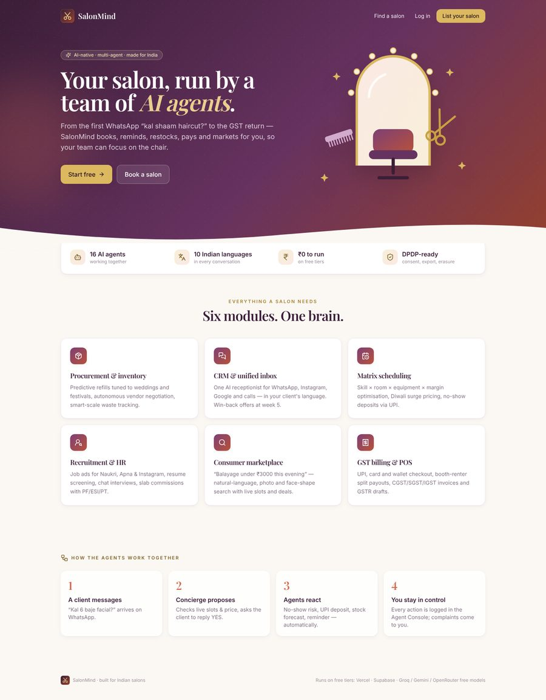
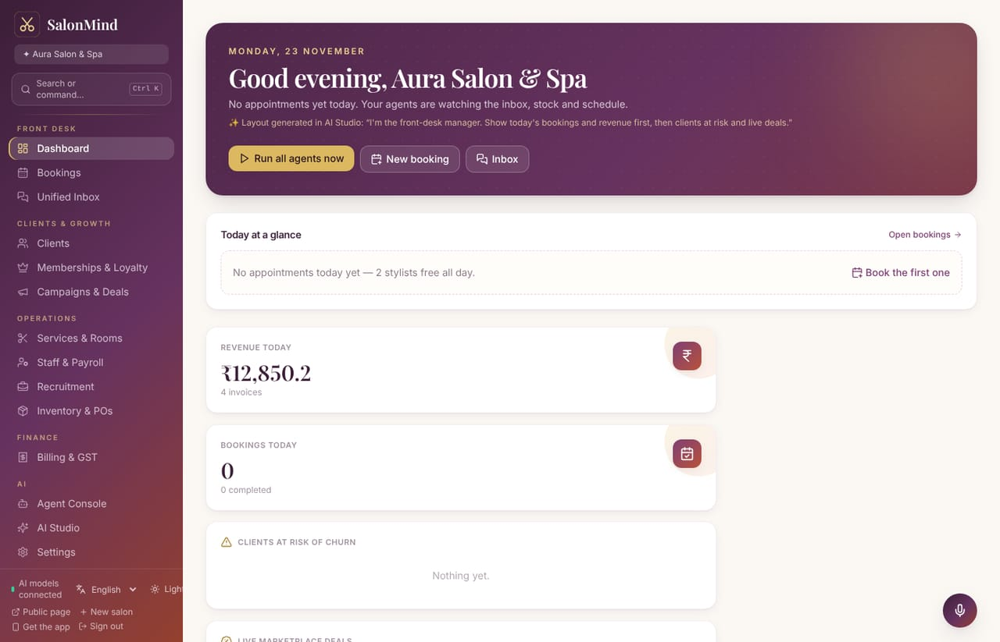
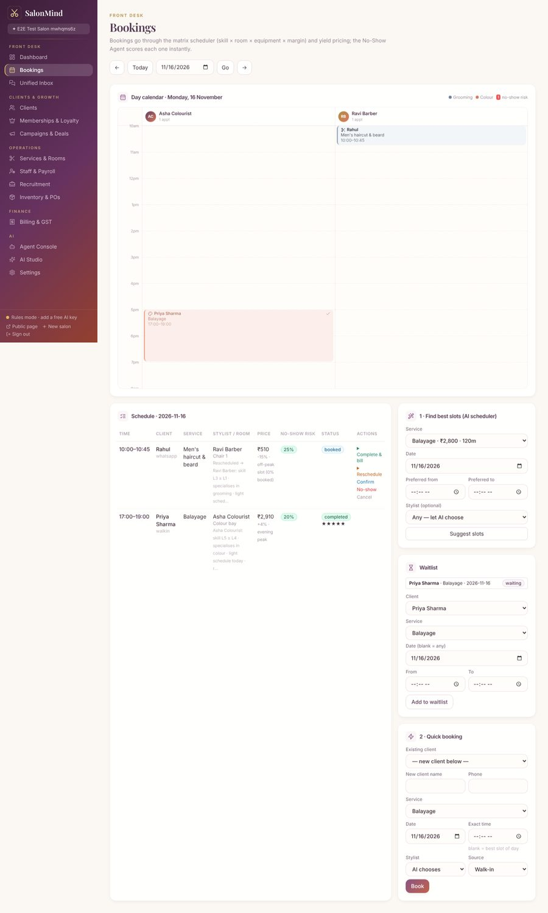
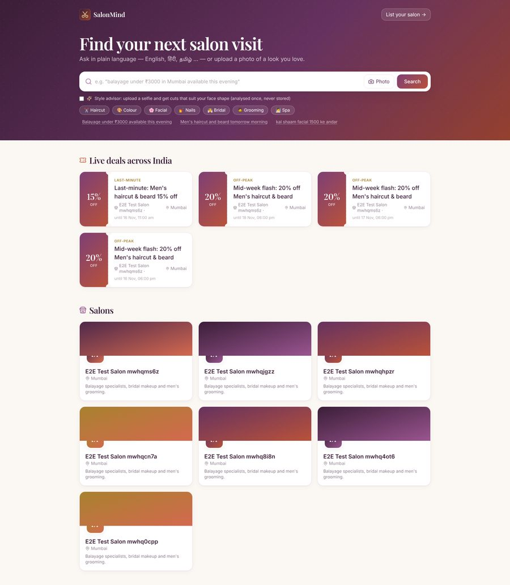
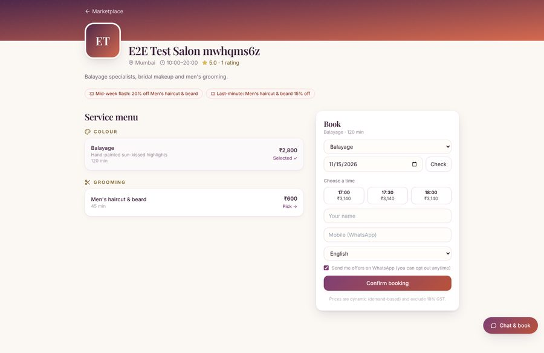
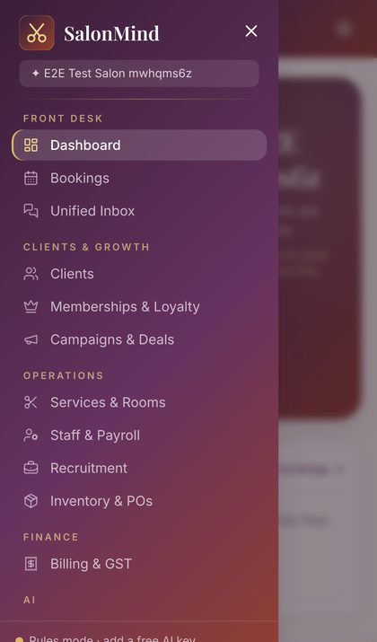
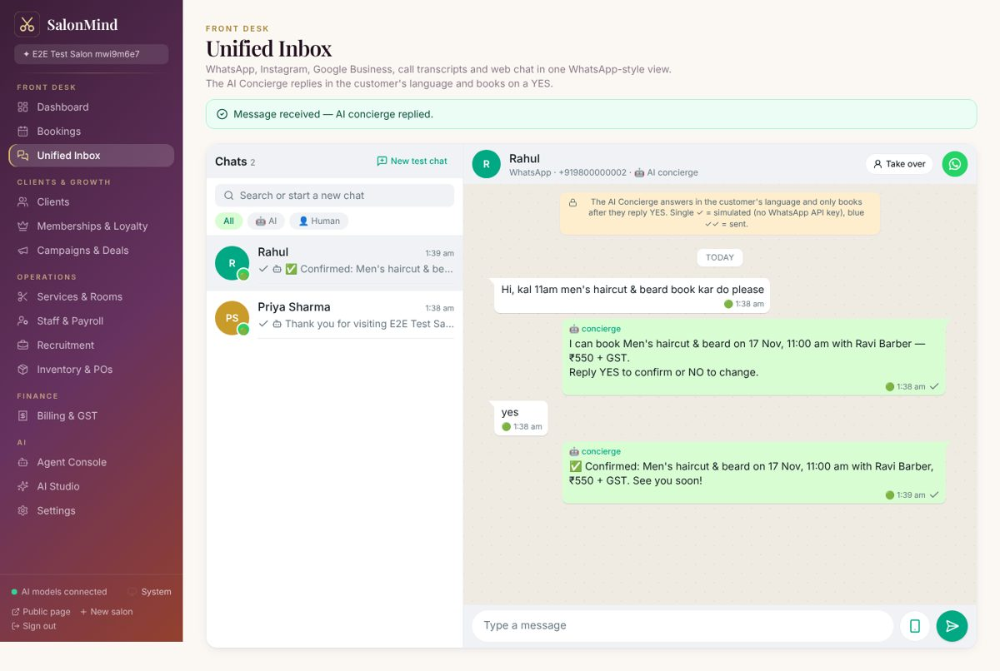
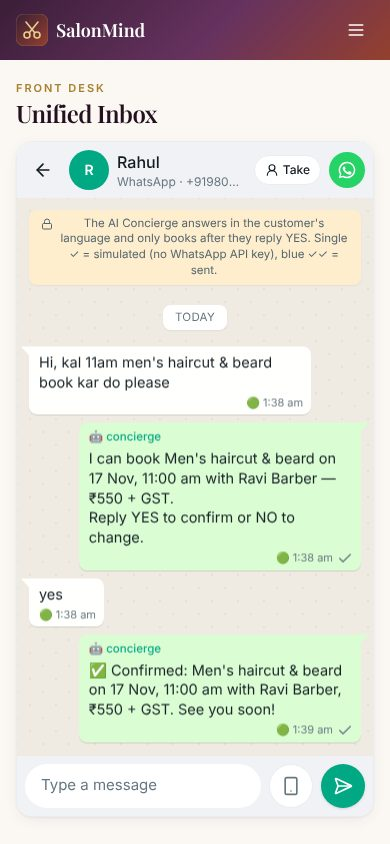
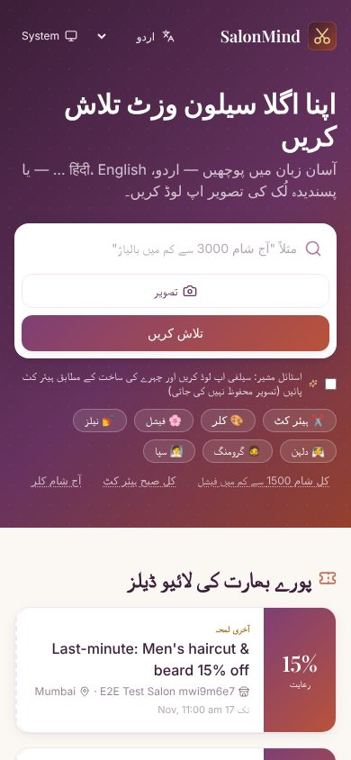

# ✂️ SalonMind — AI-native salon ERP & marketplace for India

A multi-tenant SaaS where a mesh of AI agents runs salon operations: procurement, vendor negotiation,
waste tracking, unified WhatsApp/Instagram/Google inbox, churn prediction, retention campaigns, matrix
scheduling, yield pricing, no-show mitigation, recruitment, payroll, GST billing — memberships, prepaid wallet, loyalty & referrals, waitlist, reviews — plus a consumer
marketplace with natural-language and photo search. Built from the RFP in this repo and runs **entirely
on free tiers**.

* **Live:** https://salonmind-khaki.vercel.app (owner app at `/signup`, consumer marketplace at `/marketplace`)
* **Architecture & RFP mapping:** [`docs/ARCHITECTURE.md`](docs/ARCHITECTURE.md)
* **Antigravity master prompt (plan & build):** [`docs/ANTIGRAVITY_PROMPT.md`](docs/ANTIGRAVITY_PROMPT.md) · rules in [`.agent/`](.agent)
* **Manual test script:** [`docs/TESTING.md`](docs/TESTING.md)
* **Proposal (timeline, costs, token projections):** [`docs/PROPOSAL.md`](docs/PROPOSAL.md)
* **RFP → code → test traceability:** [`docs/RFP_COVERAGE.md`](docs/RFP_COVERAGE.md) · **market research:** [`docs/RESEARCH.md`](docs/RESEARCH.md)

## Look & feel

A luxury-salon design system — deep plum, blush rose-gold and champagne on ivory, Playfair Display + Inter,
line icons — with a visual stylist day-calendar, grouped navigation (mobile drawer), installable PWA, and a
redesigned marketplace and salon booking page. Screenshots below come from an automated test salon.

| Landing | Dashboard | Day calendar |
|---|---|---|
|  |  |  |
| **Marketplace** | **Salon page** | **Mobile menu** |
|  |  |  |
| **WhatsApp-style unified inbox** | **Inbox on a phone** | **Marketplace in Urdu (RTL)** |
|  |  |  |

## Stack (all free)

Next.js 15 on Vercel Hobby · Supabase Postgres + pgvector + Auth + pg_cron (Mumbai) · **LangChain.js** LLM
layer: free Groq → Gemini → OpenRouter `:free` → Hugging Face → Ollama, optional OpenAI GPT / Anthropic Claude,
then a deterministic, multilingual rules engine. Also ships as **Kubernetes microservices** (web + agent-worker,
HPAs, CronJob) — see [`docs/DEPLOY_K8S.md`](docs/DEPLOY_K8S.md) — with AES-256-GCM field encryption
([`docs/SECURITY.md`](docs/SECURITY.md)). Light/dark themes with motion that respects reduced-motion settings.
Works with **no AI key at all** (rules-engine mode); add a free key to unlock multilingual LLM behaviour.

**13 languages, no key needed:** English, हिन्दी, বাংলা, मराठी, తెలుగు, தமிழ், ગુજરાતી, اردو (right-to-left), ಕನ್ನಡ,
ଓଡ଼ିଆ, മലയാളം, ਪੰਜਾਬੀ and অসমীয়া — for the marketplace, salon page and chat, natural-language search, and the AI
Concierge (it detects the script, understands "tomorrow 6 o'clock haircut", proposes and confirms bookings in the
customer's own language). The **Unified Inbox** looks and works like WhatsApp (chat list, ticks, wallpaper, take-over,
open in WhatsApp), and every page is checked at phone width by the E2E test.

## 16 agents

| Module | Agents |
|---|---|
| Procurement & Inventory | Procurement (predictive refill), Vendor Negotiation, Waste Tracking |
| CRM & Marketing | AI Concierge (unified inbox), Churn Analytics, Campaign (cycle, recovery, birthday), Loyalty & Referral, Reputation & Rebooking |
| Scheduling & Resources | No-Show, Yield Pricing / Deals, Waitlist (+ matrix scheduler with staff leave) |
| Recruitment & HR | Recruitment, Performance Coach (+ payroll engine) |
| Billing, POS & GST | Billing & POS, GST Compliance |
| Platform | Self-Optimizer (+ AI Studio generative dashboards) |

Also built in (ideas ported from open-source projects — see `docs/RESEARCH.md`): two-phase AI booking with
human handoff, Postgres-enforced no double-booking, UPI deposit links + QR, PF/ESI/professional-tax payroll,
CSV client import, stylist calendar (ICS) feeds and a face-shape style advisor.

Agents communicate through an event bus (`agent_events`) and log every run (`agent_runs`) — watch them
in the **Agent Console**.

## Run locally

```bash
cp .env.example .env.local   # fill Supabase URL + publishable key, agent account, CRON_SECRET
npm install
npm run dev
```

Database: apply `supabase/migrations/*.sql` to a Supabase project, then create the agent service account
with `supabase/bootstrap_agent.sql` (set your own email/password).

## Free AI keys (optional, any one)

| Provider | Get key | Env var |
|---|---|---|
| Groq (Llama 3.3 70B, Llama 4 Scout vision) | console.groq.com/keys | `GROQ_API_KEY` |
| Google Gemini (2.5 Flash, embeddings, vision) | aistudio.google.com/apikey | `GEMINI_API_KEY` |
| OpenRouter free models | openrouter.ai/keys | `OPENROUTER_API_KEY` |

After adding `GEMINI_API_KEY`, click **Settings → Re-index services** to switch search to semantic embeddings.

## Tests

```bash
npm run typecheck && npm test && npm run build      # 33 unit tests (GST, payroll, scheduler, pricing, loyalty…)
npm run test:integration                            # 39 tests against the real Supabase DB
python3 scripts/validate_k8s.py                      # static validation of the Kubernetes manifests
BASE_URL=http://localhost:3000 node tests/e2e.mjs   # browser E2E through the real UI + 390px phone audit (cleans up via account deletion)
```

## Autonomy (cron)

`/api/agents/tick` (Bearer `CRON_SECRET`) runs the orchestrator for every tenant. It is called every
30 minutes by Supabase `pg_cron` + `pg_net` (`supabase/cron.sql`) and daily by Vercel Cron.
