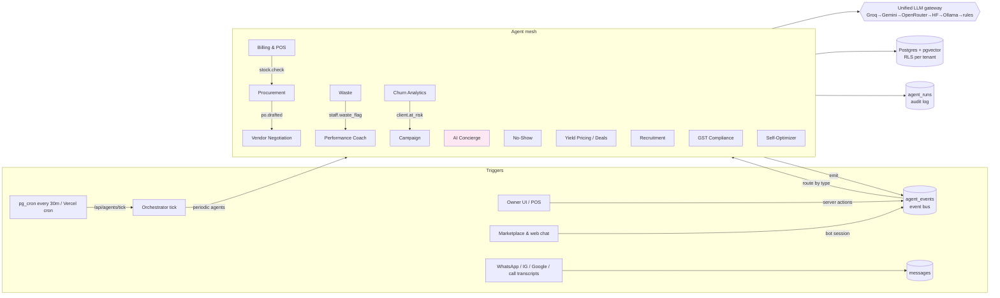

# SalonMind — Architecture (free-tier edition)

This document answers the RFP's "Architecture Blueprint" requirement: the multi-agent framework, the
multi-tenant isolation strategy, the data flow, and how each RFP module maps to running code.

## 1. RFP in one paragraph

Build an **AI-native, multi-tenant salon ERP + consumer marketplace** for India. AI is the core, not an
add-on: a **mesh of specialised agents** (procurement, scheduling, CRM, recruitment, payroll, GST …)
communicating **asynchronously** runs daily operations. Six modules: (1) procurement & inventory,
(2) CRM & marketing, (3) scheduling & resources, (4) recruitment & HR, (5) consumer marketplace &
discovery, (6) billing, POS & GST. Non-functionals: tenant isolation, festival-season spikes, Postgres +
vector DB, unified LLM abstraction, Indian languages, low-bandwidth mobile, AES-256 / DPDP.

## 2. Tech stack — 100% free tier

| Concern | Choice (free) | Why |
|---|---|---|
| Web app + API ("microservices") | **Next.js 15 App Router** on **Vercel Hobby** (region `bom1` Mumbai) | Server Components = tiny JS for 4G; route handlers & server actions are serverless functions that scale to zero and burst on Diwali spikes |
| Relational DB | **Supabase Postgres** (free, `ap-south-1` Mumbai) | Transactional billing/tenant data, RLS for isolation |
| Vector DB | **pgvector** in the same Postgres | Service embeddings for AI search — no extra vendor |
| Auth | **Supabase Auth** (email/password) | JWT → `auth.uid()` inside RLS policies |
| LLMs | **Groq** (Llama 3.3 70B, Llama 4 Scout vision) → **Gemini 2.5 Flash** → **OpenRouter `:free`** → **Hugging Face router** → **Ollama (local)** → **rules engine** | Unified abstraction (`src/lib/ai/llm.ts`) with automatic fallback; the app is fully functional with *zero* keys |
| Embeddings | **Gemini `gemini-embedding-001` @768d** or local feature-hashing embedder | Local embedder keeps vector search working with no key |
| Scheduler / cron | **Supabase `pg_cron` + `pg_net`** (every 30 min) + **Vercel Cron** (daily backup) | Drives the autonomous orchestrator tick |
| Messaging | **WhatsApp Cloud API** (Meta free tier) — optional | Without keys, outbound messages are stored as `simulated` and visible in the Inbox |
| Payments | UPI / card / netbanking recorded at POS; split payout computed; Razorpay test mode can be plugged in | No paid gateway needed to test |

> Why not Kubernetes/LangChain as the RFP suggests? On free tiers, serverless functions + Postgres give
> the same isolation/elasticity properties with zero ops. The LLM layer is a thin, dependency-free
> provider abstraction (same role as LangChain's model interface) so it runs inside 10-second
> serverless budgets. Moving to EKS/GKE later = containerising the same Next.js app + a worker that
> calls `processEvents()`.

## 3. Multi-agent framework

* **Event bus** — `agent_events` table. Producers: server actions (`booking.created`, `booking.completed`,
  `message.received`, `usage.logged`, `job.created`, …) and agents themselves (`po.drafted`,
  `client.at_risk`, `staff.waste_flag`, `stock.check`). Consumers claim events optimistically
  (`pending → processing` compare-and-set) so concurrent invocations never double-process.
* **Agents** (`src/lib/agents/*`, 20 agents) are plain async functions with a declared `subscribes[]` and
  `periodic` flag. Every run is persisted to `agent_runs` (summary, actions, raw output, LLM provider,
  duration) → full explainability in the **Agent Console**.
* **Orchestrator** (`tick()`) runs all periodic agents for a tenant, then drains the bus. Triggered by
  pg_cron, Vercel cron, or the "Run all agents" button.
* **Determinism first, LLM where language matters.** Optimisation (scheduling, pricing, forecasting,
  GST, payroll) is deterministic and unit-tested; LLMs handle language: intent extraction, multilingual
  replies, offers, negotiation emails, resume screening, sentiment, vision, dashboard generation. Every
  LLM call has a rules-engine fallback, so a provider outage never stops operations.

### Agents ↔ RFP features

| RFP feature | Agent / code | Trigger |
|---|---|---|
| Predictive stock refilling | `inventory` — usage history + booked services × recipes × festival calendar → POs | periodic, `stock.check` |
| Autonomous vendor negotiation | `negotiator` — bulk tiers + learned vendor flexibility; email thread | `po.drafted` |
| Smart waste tracking | `waste` — smart-scale/manual logs vs. recipe, per stylist | `usage.logged`, periodic |
| Autonomous campaigns (4-week cycle, week 5) | `retention` — personal visit cycle + grace → WhatsApp offer in client's language | periodic, `client.at_risk` |
| Predictive churn + recovery | `churn` — cycle drift + review sentiment + no-shows → risk ≥ 0.6 emits recovery | periodic, `booking.reviewed/completed` |
| Unified communications | `concierge` — one AI rep for WhatsApp/IG/Google/call/web; books via scheduler | `message.received` |
| Dynamic matrix scheduling | `domain/scheduling.ts` — skill × shift × room × equipment × margin × load × preference | every booking |
| Yield management pricing | `domain/pricing.ts` + `deals` agent — festival surge, off-peak flash, last-minute deals | per quote, periodic, `booking.cancelled` |
| No-show mitigation | `noshow` — logistic risk → nudges / deposits | `booking.created`, periodic |
| Sourcing & screening | `recruiter` — job ads for Naukri/Apna/IG/WhatsApp, search strings, resume score, chat interview | `job.created`, `candidate.added` |
| Payroll & commission | `computePayroll` — progressive slabs, product commission, tips, penalties, booth renters | manual |
| Performance engineering | `performance` — utilisation, ratings, waste → micro-learning | periodic, `staff.waste_flag` |
| Intent visual/text search | `services/marketplace.ts` — LLM/regex intent → pgvector + lexical → budget/city → live slots; photo → vision → query | public API |
| Aggregated deals | `deals` table, public marketplace feed | — |
| Split billing & payments | `billing` agent — owner / booth renter / tax bucket / gateway fee | `booking.completed` |
| GST engine | `billing` (CGST/SGST/IGST e-invoice + IRN ref) + `gst` agent (GSTR-1, GSTR-3B, ITC) | completion, periodic |
| Self-optimising engine | `optimizer` — tunes thresholds/caps from no-show rate & occupancy | periodic |
| Auto-generated micro-frontends | `generateLayout` (AI Studio) — NL → validated widget schema → dashboard | manual |
| *Added:* memberships, wallet, points | `billing` (checkout pricing) + `loyalty` agent (earn, referral bonus) | `booking.completed`, `invoice.issued` |
| *Added:* review requests & service recovery | `reputation` agent | `invoice.issued` |
| *Added:* automated waitlist | `waitlist` agent + concierge "YES" handling | `booking.cancelled`, periodic |
| *Added:* staff leave, rescheduling, history import | scheduler `timeOff`, `rescheduleBooking`, `logPastVisit` | — |

## 4. Multi-tenant isolation

* Every business table has `tenant_id`; **RLS policy `tenant_isolation`** = `has_tenant_access(tenant_id)`:
  caller is a member of the tenant (`tenant_members`) **or** a platform agent service account.
* The browser only ever holds the **publishable key + the user's JWT** → Postgres enforces isolation even
  if application code has a bug.
* Autonomous work (cron, marketplace, signup) runs as a dedicated **agent service account**
  (`platform_agents`), not a service-role key. Its credentials live only in Vercel env.
* Public marketplace reads are separate, narrow RLS policies (published salons, active services, live deals).
* Scale path: per-tenant indexes on `(tenant_id, start_at)`; for very large chains add Supabase read
  replicas / table partitioning by `tenant_id`, and move `processEvents` to a queue worker.

## 5. Request flow examples

**Owner completes a booking** → server action `completeBooking` → status `completed`, tip recorded →
emits `booking.completed` (+`booking.reviewed`) → `processEvents` → `billing` issues GST invoice + split
payout + consumes recipe stock → emits `stock.check` → `inventory` forecasts → maybe `po.drafted` →
`negotiator` negotiates → `churn` analyses review sentiment & rescoring → everything visible in Agent Console.

**Consumer on 4G asks "kal shaam facial 1500 ke andar"** → `/api/marketplace/search` → intent JSON
(LLM, or regex fallback) → embedding → `match_services` (pgvector) + lexical → price/city filter →
`planBooking` per salon for live slots with yield pricing → results with bookable slots.

## 6. Security & compliance

* TLS everywhere; Supabase storage encrypted at rest with AES-256.
* RLS isolation, least-privilege RPCs (`create_tenant`, `provision_user` gated to platform agent).
* DPDP: explicit marketing consent per client, data export (`/api/clients/:id/export`), right-to-erasure
  (anonymises PII, keeps de-identified tax records), agents never message clients without consent.
* Full audit trail of autonomous actions (`agent_runs`, `agent_events`).
* **No double booking, ever**: Postgres exclusion constraints on (stylist, time range) and (room, time range)
  for live bookings — holds even when two serverless functions race during a Diwali rush.
* **Two-phase AI actions**: the concierge can only *propose* a booking (frozen service/date/time/price in
  `booking_proposals`); it executes only after the customer's explicit YES. Complaints or two unclear
  messages hand the thread to a human (`conversations.status = 'human'`) and the AI goes silent.
* Prompt-injection hygiene: LLM output is parsed into typed JSON and validated (e.g. Studio widgets must
  exist in the registry; concierge only books through the scheduler; prices come from DB, never the model).

## 7. Phase plan (RFP §5)

| Phase | Scope | Status in this repo |
|---|---|---|
| Discovery | RFP analysis, architecture, agent catalogue | ✅ this doc + `docs/ANTIGRAVITY_PROMPT.md` |
| MVP | All 6 modules, 13 agents, marketplace, GST, free-tier deploy | ✅ |
| Beta | Real WhatsApp Cloud API number, Razorpay Route split settlements, GSP e-invoice (IRP) integration, voice screening (Whisper/Groq STT) | pluggable — env keys / adapters |
| Enterprise | Branch hierarchies for chains, read replicas, queue workers, SOC 2 controls, ISO 27001 ISMS | roadmap |

## 8. AI token projections (free tier)

Per completed booking ≈ 2–4 LLM calls (sentiment, nudge, offer) ≈ 1.5k tokens. Per inbound message ≈ 2
calls ≈ 2k tokens. A salon doing 40 bookings + 60 messages/day ≈ 180k tokens/day — inside Groq's and
Gemini's free daily limits for a handful of salons; beyond that, the provider chain fails over and the
rules engine keeps operations running.
