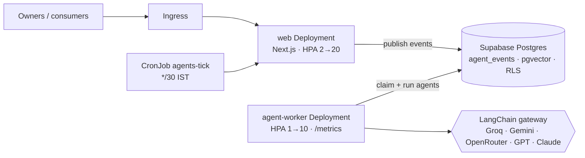

# Kubernetes deployment (RFP §4: cloud-native microservices, EKS/GKE, serverless for spikes)

SalonMind runs in two supported topologies from the same code:

| Topology | Where | Agents run… | Cost |
|---|---|---|---|
| **Serverless** (default) | Vercel functions + Supabase | inline after each request + cron tick | free tier |
| **Kubernetes microservices** | GKE / EKS / any cluster | `agent-worker` Deployment consumes the event bus asynchronously | cluster cost (see PROPOSAL / ARCHITECTURE §8) |



## Services

| Manifest | Kind | Notes |
|---|---|---|
| `web.yaml` | Deployment + Service + HPA + PDB | `AGENT_EXECUTION=worker` → web only publishes events. Rolling updates with zero unavailable; HPA scales on CPU for Diwali/wedding-season spikes. |
| `agent-worker.yaml` | Deployment + HPA + Service | `services/agent-worker` — claims events atomically (`pending→processing`), so replicas never double-process. `/healthz`, `/readyz`, Prometheus `/metrics`. |
| `cronjob-tick.yaml` | CronJob | Every 30 min (Asia/Kolkata): periodic agents (forecast, campaigns, deals, GST, optimizer). |
| `ingress.yaml` | Ingress | nginx by default; GKE `gce` + ManagedCertificate or EKS ALB + ACM. |
| `config.yaml`, `secret.example.yaml` | ConfigMap / Secret | Secrets via Secret Manager / AWS Secrets Manager in production. |

All pods run as non-root with `RuntimeDefault` seccomp, no privilege escalation and dropped capabilities.

## Build images

```bash
docker build -t salonmind-web:local \
  --build-arg NEXT_PUBLIC_SUPABASE_URL=... --build-arg NEXT_PUBLIC_SUPABASE_ANON_KEY=... --build-arg NEXT_PUBLIC_APP_URL=https://... .
docker build -t salonmind-worker:local -f services/agent-worker/Dockerfile .
```

## Run locally (kind)

```bash
kind create cluster --name salonmind
kind load docker-image salonmind-web:local salonmind-worker:local --name salonmind
cp deploy/k8s/secret.example.yaml deploy/k8s/secret.yaml   # fill in, never commit
kubectl apply -f deploy/k8s/namespace.yaml -f deploy/k8s/secret.yaml
kubectl apply -k deploy/k8s
kubectl -n salonmind port-forward svc/web 8081:80
```

## GKE Autopilot (Mumbai) / EKS

```bash
gcloud container clusters create-auto salonmind --region asia-south1
gcloud artifacts repositories create salonmind --repository-format docker --location asia-south1
docker tag salonmind-web:local asia-south1-docker.pkg.dev/$PROJECT/salonmind/web:$SHA   # likewise agent-worker
# set the `images:` block in kustomization.yaml, then
kubectl apply -k deploy/k8s
```
EKS: `eksctl create cluster --name salonmind --region ap-south-1 --nodes 2`, push to ECR, switch the Ingress to `alb`.

## Verified here

- Both images build from this repo; containers run with the production config.
- `tests/integration/microservices.test.mts` (run with `WEB_URL` + `WORKER_METRICS_URL`) proves the topology on the
  real database: the web container publishes `booking.created`, the **agent-worker container** consumes it
  asynchronously (No-Show Agent runs), health/readiness/metrics endpoints respond.
- Not verified here: a live `kind`/GKE cluster (the sandbox did not permit creating a nested cluster).
